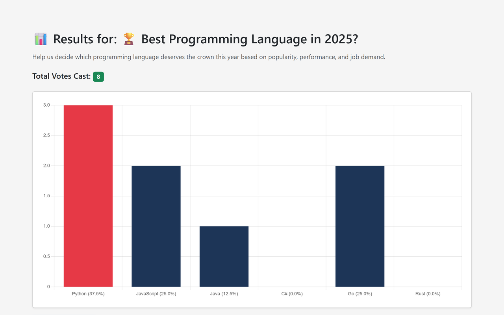

# VoteVision

VoteVision is an educational online voting platform for creating elections and polls, managing candidates, casting votes, and viewing results. It was built as a Computer Science project with PHP and MySQL.

> This repository is a demonstration project. It has not been independently security-audited and should not be used for governmental, financial, or other high-stakes elections.

## Screenshots




## Features

- User registration, login, and profile management
- Election events, candidate lists, and candidates
- Public polls with configurable choices
- Duplicate-vote prevention for registered users
- Live results and chart visualization
- Poll expiration countdowns and shareable links
- Responsive interface built with Bootstrap

## Technology Stack

- PHP 8+
- MySQL or MariaDB
- HTML, CSS, and JavaScript
- Bootstrap, jQuery, and Chart.js
- Tesseract OCR for optional identity-document processing

## Local Setup

1. Install XAMPP or another PHP/MySQL environment.
2. Clone the repository into your web server directory:

   ```bash
   git clone https://github.com/jad-obeidd/VoteVision.git
   ```

3. Create a database named `election`.
4. Import `database/schema.sql` using phpMyAdmin or the MySQL command line.
5. Configure the database environment variables shown in `.env.example`, or use the default XAMPP values in `connection.php`.
6. Make the `uploads` directory writable by the web server.
7. Open the project through your local server, for example `http://localhost/VoteVision/`.

The included database file contains schema only and no real users, credentials, identity data, or voting records. Register a new account after importing it. To test administrator-only screens locally, change that account's `role_id` from `1` to `2` in the database.

## Project Structure

```text
VoteVision/
├── database/schema.sql   # Sanitized database schema
├── images/               # Static interface assets
├── uploads/              # Runtime user uploads (ignored by Git)
├── connection.php        # Database connection
├── index.php             # Landing page
├── login.php             # Authentication handler
├── register2.php         # Registration handler
└── *.php                 # Election, poll, profile, and result pages
```

## Privacy

Do not commit production database exports or files from `uploads/`. Database dumps may contain names, emails, password hashes, identity-document OCR results, IP addresses, and voting history.

## Author

**Jad Obeid**  
[GitHub](https://github.com/jad-obeidd) · [LinkedIn](https://www.linkedin.com/in/jad-obeid-dev)

## License

This project is shared for educational and portfolio purposes.
